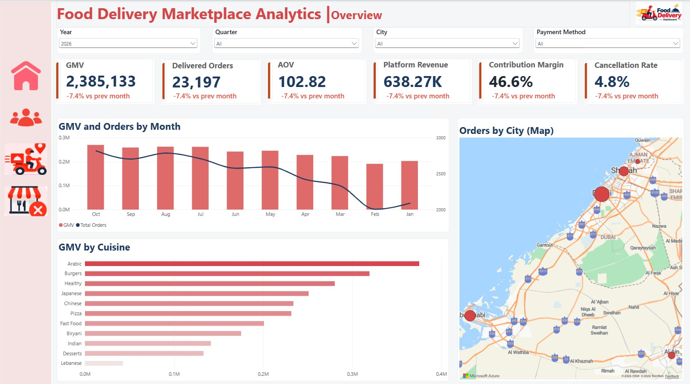
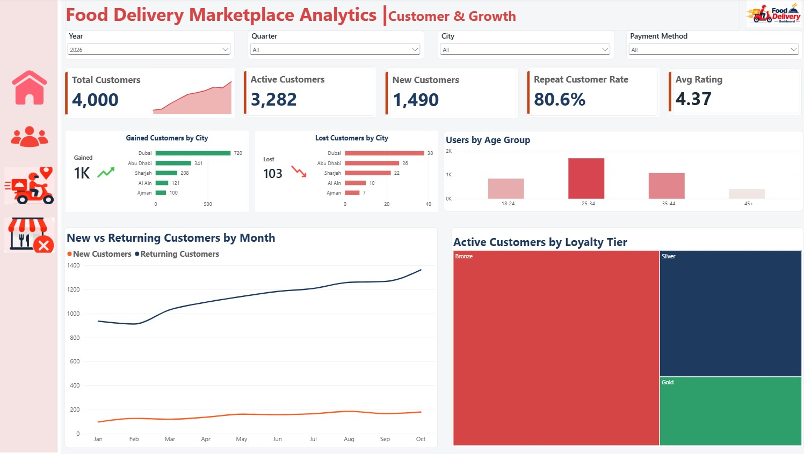
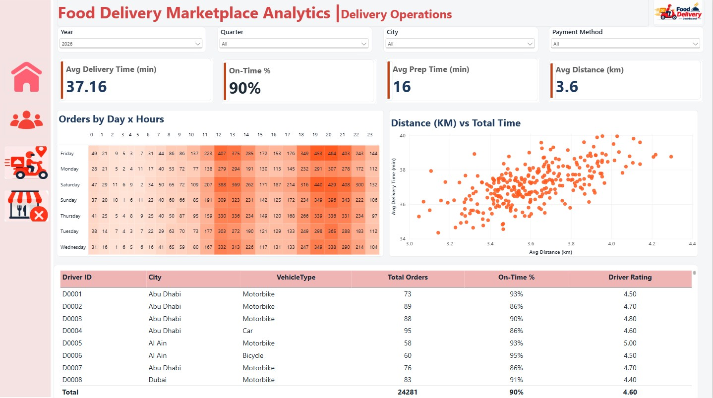
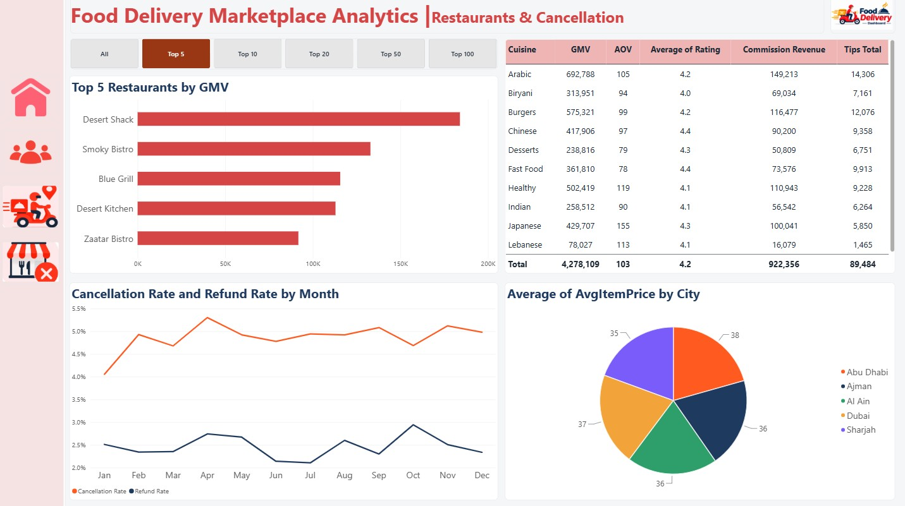

# Food Delivery Marketplace Analytics

An interactive **Power BI** dashboard that tracks sales, delivery operations, customer growth and restaurant performance for a UAE-based food delivery app. It turns 45,000 order records into four decision-focused report pages.

> The dataset is synthetic (generated for practice and portfolio use). It is not real company data.

---

## Dashboard Preview

### 1. Overview
Executive view of sales and profitability: GMV, orders, AOV, platform revenue, contribution margin and cancellation rate, with monthly trend, geographic split and cuisine performance.



### 2. Customers and Growth
Customer base health: active vs new customers, repeat rate, gained and lost customers by city, age groups and loyalty tiers.



### 3. Delivery Operations
Operational efficiency: delivery and prep time, on-time %, order demand by day and hour, distance vs delivery time, and driver-level performance.



### 4. Restaurants and Cancellations
Partner performance and order quality: top restaurants by GMV (Top N selector), cuisine scorecard, cancellation and refund trends.



---

## Business Questions Answered
- How much are we selling and earning, and how profitable is each order after discounts and driver pay?
- Which cities and cuisines drive the most GMV?
- Are orders delivered on time, and when does demand peak?
- Are we gaining new customers and keeping existing ones?
- Which restaurants perform best, and why do orders get cancelled or refunded?

## Key Features
- 4 report pages with sidebar navigation and consistent slicers (Year, Quarter, City, Payment Method)
- KPI cards with month-over-month comparison
- Map visual for city-level order distribution
- Day x Hour heatmap matrix to find peak demand windows
- Top N restaurant selector (Top 5 / 10 / 20 / 50 / 100) built with bookmarks
- Driver and cuisine scorecards with conditional formatting
- Custom theme (orange and navy) applied across all pages

## Data Model
Star schema with one fact table and dimension tables:

| Table | Type | Description |
|---|---|---|
| Fact_Orders | Fact | 45,000 orders: status, amounts, fees, discounts, tips, delivery times, ratings |
| Fact_Targets | Fact | Monthly order and GMV targets by city |
| Dim_Date | Dimension | Calendar (Jan 2025 - Dec 2026) |
| Dim_Customer | Dimension | 4,000 customers: city, channel, age group, loyalty tier, first order date |
| Dim_Restaurant | Dimension | 140 restaurants: cuisine, partner tier, commission %, rating |
| Dim_Driver | Dimension | 300 drivers: city, vehicle type, employment type, rating |
| Dim_City | Dimension | 5 UAE cities with coordinates for the map |

**Relationships:** all one-to-many, single direction, from each dimension to `Fact_Orders` (Date, Customer, Restaurant, Driver, City). `Fact_Targets` connects through `Dim_City`, and the target measures use `TREATAS` on the month start date.

## Key Measures (DAX)

| Area | Measures |
|---|---|
| Sales and profit | GMV, AOV, Platform Revenue, Contribution Margin, Contribution Margin % |
| Orders | Delivered Orders, Cancelled Orders, Cancellation Rate, Refund Rate |
| Delivery | Avg Delivery Time, Avg Prep Time, On-Time %, Avg Distance |
| Customers | Active Customers, New Customers, Returning Customers, Repeat Customer Rate |
| Time intelligence | MoM %, YoY %, YTD, vs Target % |
| Ranking | Restaurant Rank by GMV, Top N filter |

Example:

```dax
On-Time % =
VAR _completed =
    CALCULATE ( COUNTROWS ( Fact_Orders ), Fact_Orders[OrderStatus] <> "Cancelled" )
RETURN
    DIVIDE ( _completed - [Late Orders], _completed )
```

The full list is in `FoodDelivery_Measures.dax`.

## Insights Visible in the Dashboard
- **Sales:** Arabic, Burgers and Healthy are the top cuisines by GMV; Dubai is the largest city by orders.
- **Demand pattern:** orders peak at lunch (12:00-14:00) and dinner (19:00-21:00), with Fridays and Saturdays the busiest days.
- **Delivery:** average delivery time is about 37 minutes with 90% on-time delivery; longer distances increase delivery time as expected.
- **Customers:** repeat customer rate is about 81%, and Dubai gains the most new customers.
- **Quality:** cancellation rate stays near 5% and refund rate near 2.5% throughout the year.

## Tools and Skills Demonstrated
Power BI Desktop | DAX | Power Query | Star-schema data modelling | Bookmarks and drill-through | Conditional formatting | Dashboard UX design | Python (synthetic data generation)

## Repository Structure
```
Food-Delivery-Marketplace-Analytics-Project/
|-- data/                                      # CSV source files (7 tables)
|-- Food Delivery Marketplace Analytics.pbix   # Power BI report
|-- FoodDelivery_Measures.dax                  # All DAX measures
|-- FoodDelivery_Theme.json                    # Power BI theme
|-- screenshotspage1.jpg ... screenshotspage4.jpg
`-- README.md
```

## How to Use
1. Download this folder and open `Food Delivery Marketplace Analytics.pbix` in Power BI Desktop.
2. If prompted, update the data source path: **Transform data > Source_Folder > point to the `data` folder**.
3. Click **Refresh**.

To rebuild from scratch, load the CSVs with the Folder connector, create the relationships above, add the measures from the `.dax` file and import the theme.

## Author
**Sameer Abbas**, Data Analyst | Power BI Developer, Dubai, UAE
[LinkedIn](https://linkedin.com/in/sameer-abbas-6ba12b24a) | [GitHub](https://github.com/SameerAbbas087)
